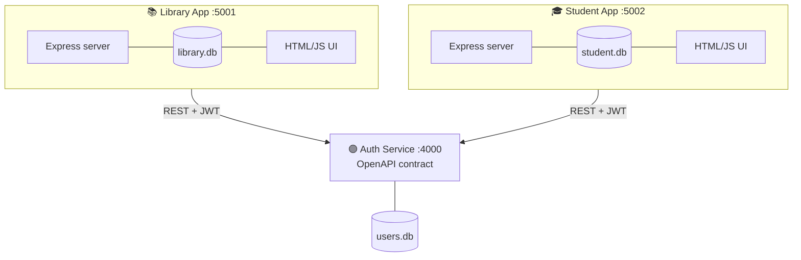
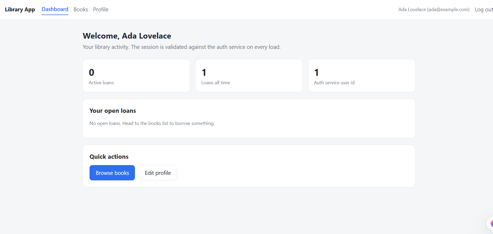
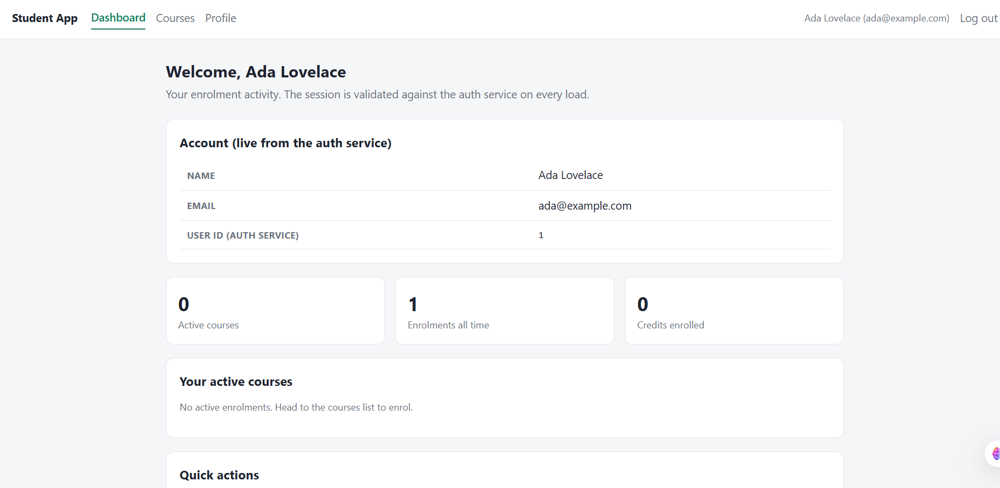
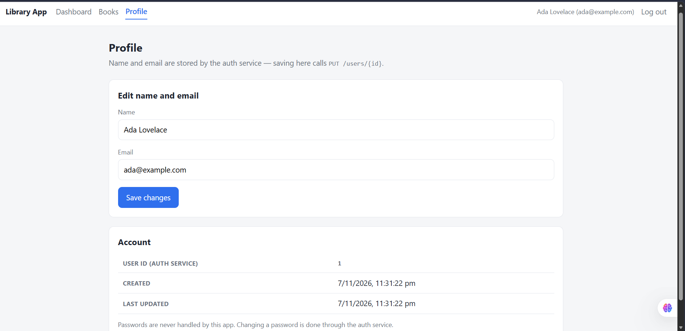
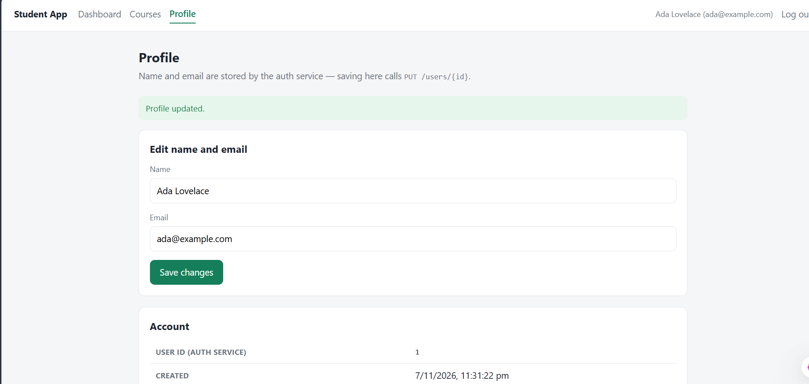
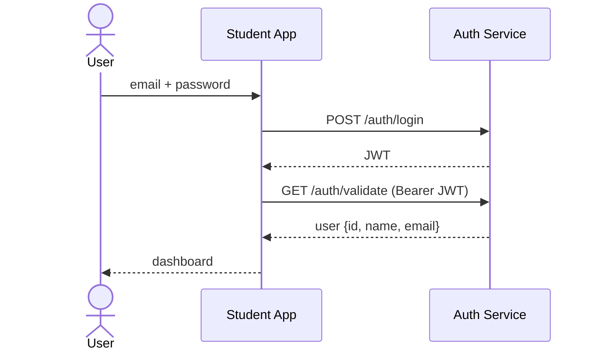
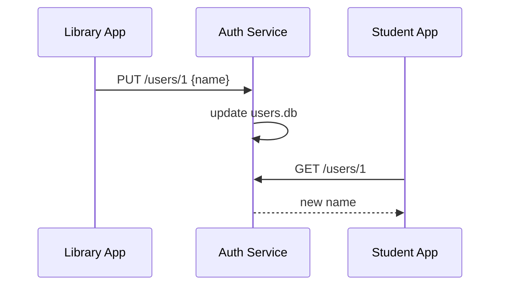

# ◆ Authbridge

**One reusable service. Two independent monoliths. Zero duplicated login logic.**

A Service-Oriented Architecture (SOA) project: a single **Auth & User Service** is built once and reused by two separate monolithic applications. A profile update made through one application is reflected in the other, because both depend on the same service.


[Problem](#-problem-statement) • [Architecture](#-architecture) • [Screenshots](#-screenshots) • [How it works](#-how-it-works) • [Run it](#-getting-started) • [Demo](#-live-demo-script) • [API](#-service-api)

---

## 📌 Problem Statement

In many organisations, several applications are built separately as monolithic systems. Each has its own server, database and user interface. When the same feature is needed in more than one of them, every application builds and maintains its own copy of it. That causes:

| Problem | Effect |
|---|---|
| 🔁 Duplicated effort | The same logic and business rules are written, tested and maintained in every application |
| ⚠️ Inconsistent data | Each app keeps its own copy, so a change in one is not seen in the others |
| 🚫 No reuse | A feature built for one app cannot be used by another, even when the need is identical |
| 🔗 Tight coupling | Changing a common rule means modifying and redeploying every application |
| 📈 Hard to extend | Every new application builds the same feature again |

**Objective:** build a reusable service, use it in two independent monolithic applications, show that an update in one is reflected in the other, and demonstrate the core SOA principles.

## 💡 The Solution

Authbridge implements a shared **Auth & User Service** that owns identity data and every rule around it:

- 🟣 **Auth Service** is the reusable service. It owns users, credentials and profiles, issues JWTs and enforces the rules.
- 📚 **Library App** is monolith #1: books and loans.
- 🎓 **Student App** is monolith #2: courses and enrolments.

A user registers once, logs in to either app with the same credentials, and sees the same name and email in both. Change the name in one app and the other shows it too.

## 🏗 Architecture



| Component | Role | Port | Owns this data |
|---|---|---|---|
| **Auth Service** | The reusable service: REST contract, JWT, user rules | 4000 | `users.db`: users |
| **Library App** | Monolith #1: own server, own DB, own UI | 5001 | `library.db`: books, loans |
| **Student App** | Monolith #2: own server, own DB, own UI | 5002 | `student.db`: courses, enrolments |

> Neither monolith stores credentials or profile data. The Auth Service is the single source of truth. The apps refer to users only by `userId`.

### SOA principles demonstrated

| Principle | Where you can see it |
|---|---|
| **Service reusability** | One service, consumed by two apps through the same contract |
| **Well-defined service contract** | `contract/openapi.yaml` and Swagger UI at `:4000/docs` |
| **Loose coupling** | Apps talk to the service only over HTTP, with the URL set in `.env`. No shared DB, no shared code |
| **Centralised data ownership** | Only `auth-service` opens `users.db` |
| **Service autonomy** | The service's hashing and storage can change without touching either app |

## 📸 Screenshots

| 📚 Library App | 🎓 Student App |
|---|---|
|  |  |

| Profile edited in Library App | Same change visible in Student App |
|---|---|
|  |  |

## ⚙ How It Works

### 1. Login: a monolith using the reusable service



### 2. An update in one monolith is reflected in the other



### 3. Loose coupling: one app is down

Stop the Library App. The Student App and the Auth Service keep working, because the apps never call each other.

## 🚀 Getting Started

**Prerequisite:** Node.js 18 or newer.

```bash
git clone https://github.com/Sajitha1912/Authbridge.git
cd Authbridge
npm run setup       # installs dependencies for every component
```

Copy each environment template before starting (on Windows PowerShell, use `copy` instead of `cp`):

```bash
cp auth-service/.env.example auth-service/.env
cp app-library/.env.example app-library/.env
cp app-student/.env.example app-student/.env
```

Start everything:

```bash
npm run start:all   # starts the auth service and both apps
```

| Open | URL |
|---|---|
| 📚 Library App | http://localhost:5001 |
| 🎓 Student App | http://localhost:5002 |
| 🟣 Auth Service Swagger UI | http://localhost:4000/docs |

Run the tests:

```bash
npm test
```

Reset the demo data: stop the servers and delete `*/*.db`. Seed data is created again on the next start.

## 🎬 Live Demo Script

| # | Step | Expected result |
|---|---|---|
| 1 | Log in to the Library App as the demo user | Dashboard shows name and email from the Auth Service |
| 2 | Open Profile and change the display name | Saved through `PUT /users/{id}` |
| 3 | Open the Student App and log in with the same credentials | The new name appears, with no change to the Student App |
| 4 | Stop the Library App | The Student App and Auth Service still work |
| 5 | Stop the Auth Service | Apps show a clear "auth service unavailable" message |
| 6 | Search the repo for `users.db` | Only `auth-service` references it |

## 📡 Service API

Full contract: [`contract/openapi.yaml`](contract/openapi.yaml). Errors are returned as JSON.

| Method | Endpoint | Auth | Result |
|---|---|---|---|
| POST | `/auth/register` | none | 201 new user, 409 if it exists |
| POST | `/auth/login` | none | 200 with JWT, 401 on bad credentials |
| GET | `/auth/validate` | Bearer | The user behind the token, or 401 |
| GET | `/users/{id}` | Bearer | The user, or 404 |
| PUT | `/users/{id}` | Bearer | Updates name, email or password |
| GET | `/health` | none | Service status |

## 📁 Project Structure

```
Authbridge/
├── auth-service/       🟣 The reusable service (users.db lives here only)
├── app-library/        📚 Monolith #1: server, library.db, UI, authClient.js
├── app-student/        🎓 Monolith #2: server, student.db, UI, authClient.js
├── contract/           openapi.yaml (the service contract)
├── scripts/            Helper scripts
└── docs/               Architecture, test report, screenshots
```

## ✅ Testing

Automated tests use `supertest` against the Auth Service.

| Component | Tests | Covers |
|---|---|---|
| Auth Service | N | Register, login, validate, update, error cases |

## 🧰 Tech Stack

| Layer | Technology |
|---|---|
| Runtime | Node.js (Express) |
| Database | SQLite, one DB per component |
| Auth | JWT, bcrypt password hashing |
| Contract | OpenAPI + Swagger UI |
| Frontend | Vanilla HTML, CSS and JS |
| Testing | supertest |

## 📚 Documentation

- 🗺 [Architecture](docs/architecture.md)
- 🧪 [Test report](docs/test-report.md)

## 🔭 Future Scope

API gateway · service discovery · refresh tokens and OAuth2 · PostgreSQL · containerisation with Docker · more consumer applications · rate limiting and audit logging.

---

Built by **Sajitha V** for the Service Oriented Architecture course.
